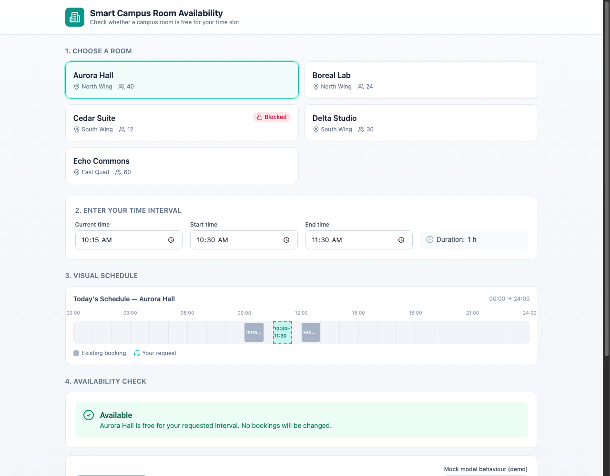
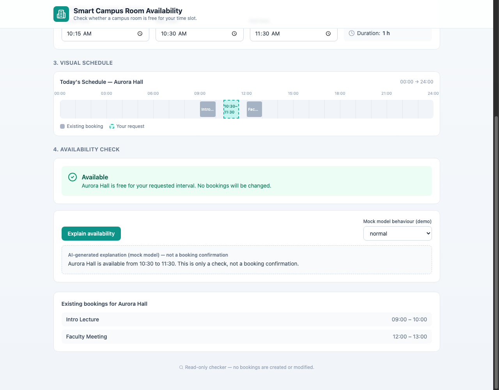
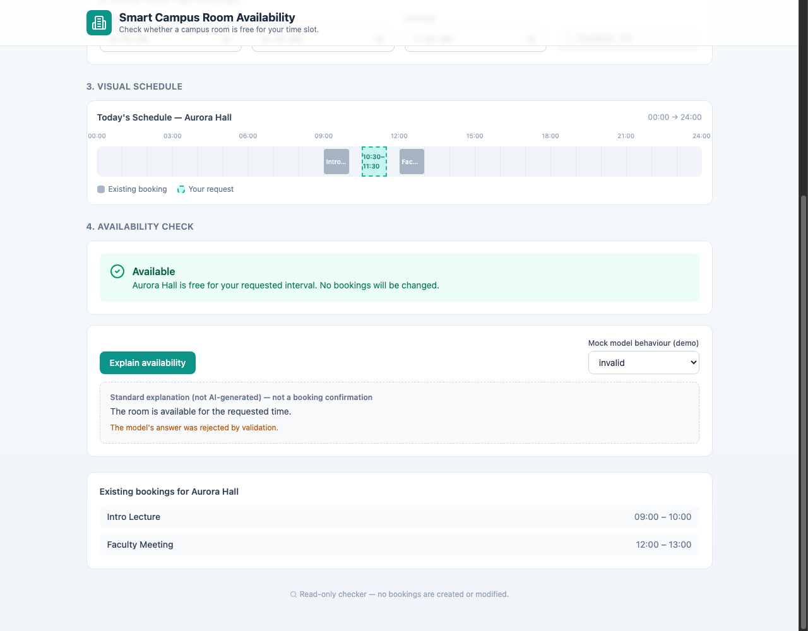
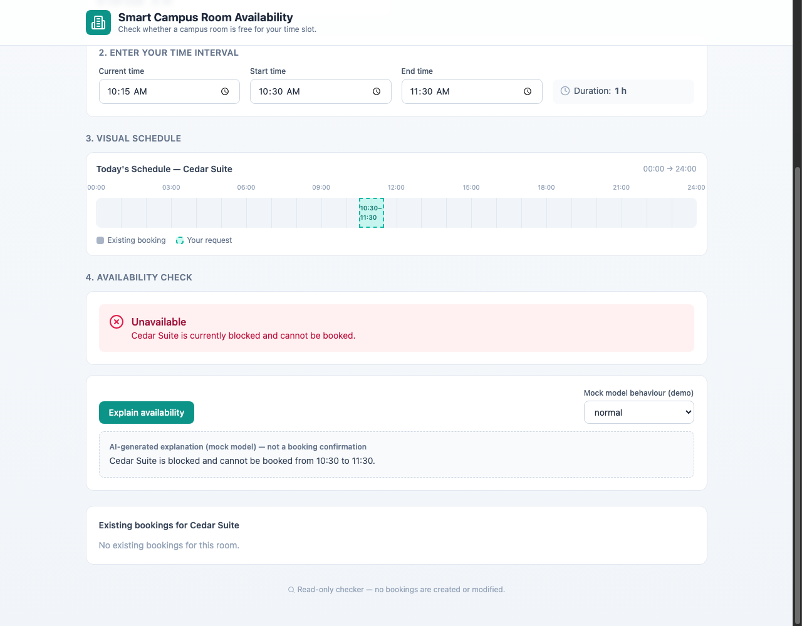
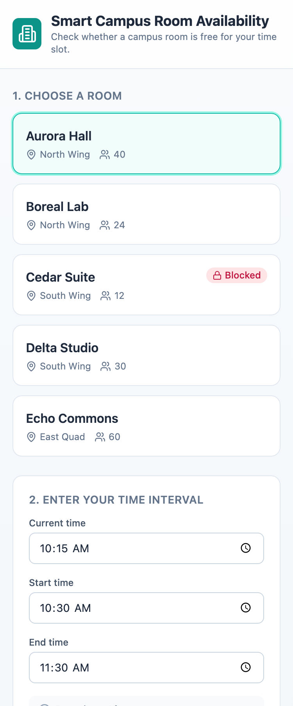

# Assignment #05 — Agent-Readiness Audit, Risk Review and Release Decision

**Repository:** Smart Campus Room Availability Checker (`project/` in `Downloads/smart-campus-practice12`)
**Baseline:** git commit `b4edba3` (clean tree before this work)
**Final state:** working-tree changes on top of `b4edba3`, not committed (see §11)
**Date:** 2026-11-20
**Decision: CONDITIONAL** · **Readiness level: 2 (Documented)**

---

## 0. Summary

| Item | Result |
|---|---|
| Tests (Vitest) | Before **53/53** pass · After **60/60** pass (7 added, 0 existing assertions changed) |
| Typecheck / lint / build | Before exit 0 / 0 / 0 · After exit 0 / 0 / 0 |
| Production dependency audit (`npm audit --omit=dev`) | **0 vulnerabilities** before and after |
| Dev-toolchain audit (`npm audit`) | **24 vulnerabilities** (2 critical, 13 high, 7 moderate, 2 low) — not fixed, see R-03 |
| Risks evaluated | 6 candidate findings (5 categories), 1 classified unsupported |
| Mitigations implemented | 2 for confirmed risks (R-01, R-02), 1 focused refactoring (R-04) |
| Top-two confirmed risks | R-01 (validator bypass), R-02 (reason-code list unguarded) |

---

## 1. Repository choice

I picked `project/` from the `smart-campus-practice12` repository. It is small (about 18 source and test files, ~1,500 lines), has a clean git history with a commit to use as baseline, a committed lockfile, and a real testable behaviour (AC1–AC6 booking rules, 53 tests). It has a user interface, which allowed desktop and mobile screenshots. The assignment says the Smart Campus project is *not required*, not forbidden; I chose it because it best met the criteria. It contains no secrets, no `.env` files and no personal data (checked, §6).

---

## 2. Task #01 — Baseline and context

### 2.1 Repository map

| Area | Files |
|---|---|
| Entry point | `index.html` → `src/main.tsx` → `src/App.tsx` |
| Pure booking rules (AC1–AC5) | `src/availability.ts` (`checkAvailability`, `getInputHints`) |
| Time helpers | `src/timeUtils.ts` |
| Types / fixtures | `src/types.ts`, `src/sampleData.ts` (read-only) |
| UI | `src/components/` — `RoomSelector`, `Timeline`, `ResultPanel`, `ExplainPanel` |
| Optional LLM explanation | `src/explain/` — `contract.ts` (validation), `prompt.ts`, `adapters.ts` (mock only), `explainAvailability.ts` (timeout + fallback) |
| Tests | `src/availability.test.ts` (27 tests), `src/explain/explain.test.ts` (26 tests) |
| Build/tooling | `package.json`, `package-lock.json`, `vite.config.ts`, `tsconfig*.json`, `eslint.config.js`, `tailwind.config.js` |
| Agent docs | `AGENTS.md`, `README.md`, `.bolt/prompt` |

### 2.2 Commands run and actual results

Commands were run from `project/` in the order below. Full output is in `audit/evidence/`.

| # | Command | Result | Evidence file |
|---|---|---|---|
| 1 | `npm ci` | exit 0; npm 11.20.0 warned that `esbuild` and `fsevents` install scripts are not covered by `allowScripts` | (install log, not kept) |
| 2 | `npx vitest run` | **Test Files 2 passed, Tests 53 passed**, exit 0 | `01_baseline_test.txt` |
| 3 | `npm run typecheck` | exit 0 | `02_baseline_typecheck.txt` |
| 4 | `npm run lint` | exit 0 | `03_baseline_lint.txt` |
| 5 | `npm run build` | exit 0 (`built in 543ms`) | `04_baseline_build.txt` |
| 6 | `npm audit --omit=dev` | **found 0 vulnerabilities**, exit 0 | `05_baseline_audit.txt` |
| 7 | `npm audit` (full) | **24 vulnerabilities** (2 low, 7 moderate, 13 high, 2 critical) | `06_full_audit.txt` |

### 2.3 Acceptance criteria (must remain true after changes)

| ID | Criterion | How it is checked |
|---|---|---|
| AC-A | All 53 baseline tests pass, none edited or deleted | `npx vitest run` |
| AC-B | Typecheck, lint and build exit 0 | `npm run typecheck`, `npm run lint`, `npm run build` |
| AC-C | No production dependency vulnerabilities | `npm audit --omit=dev` |
| AC-D | The deterministic decision stays the only source of truth; invalid model output falls back and is labelled | existing explain tests + screenshot `05_explain_invalid_model_fallback.png` |
| AC-E | No horizontal overflow at 375 px; desktop layout intact | measured `scrollWidth` 375 = `innerWidth` 375 (`evidence/13_cdp_measurements.json`); screenshots 03 and 07 |

### 2.4 Weaknesses with evidence (≥ 3 required)

| # | Weakness | Evidence |
|---|---|---|
| W1 | The explanation validator accepts "free" / "open" for an **unavailable** decision | Probe: `validateExplanation("Aurora Hall is free from 10:30 to 11:30 because it overlaps an existing booking.", unavailable)` → `{"ok":true}`; "open" gives the same. The control word "available" is rejected. |
| W2 | `REASON_CODES` (a plain array) is not checked against the `ReasonCode` union | `src/explain/contract.ts` declares `REASON_CODES: readonly ReasonCode[]`; no test compares it with the union. |
| W3 | 24 advisories in the development toolchain | `audit/evidence/06_full_audit.txt` (`@babel/core`, `esbuild`, `vitest`/`vite` chain, `picomatch`, `brace-expansion`, …). |
| W4 | Duplicated time formatter | `src/availability.ts` had `formatClock`, identical to `minutesToLabel` in `src/timeUtils.ts` (`grep -n "function formatClock\|function minutesToLabel" -r src`). |
| W5 | No automated test for the UI or responsive layout (AC6) | `find src -name "*.test.*"` → only the two logic test files; no DOM-testing library in `package.json`. |

### 2.5 Observed facts vs assumptions vs AI suggestions

| Statement | Class |
|---|---|
| All 53 tests, typecheck, lint, build pass at baseline | **Observed** (commands above) |
| Production has 0 advisories | **Observed** (`npm audit --omit=dev`) |
| "Full audit shows 2 critical advisories, so the app is exposed" | **Unsupported** as a production claim — the critical advisories are in dev tooling, and production audit is clean |
| The validator bypass is user-visible | **Assumption** until a real model produces such text; the mock never does. Reproduced at unit level only. |
| The shipped mock never produces "free" | **Observed** (`adapters.ts` templates) |
| A real model adapter would produce "free" | **Assumption** — not tested, no real adapter exists |
| Claude Code loads `CLAUDE.md` but not `AGENTS.md` | **Assumption** — not verified against the docs in this session |

---

## 3. Task #02 — Agent instructions

### 3.1 What existed
`AGENTS.md` already contained purpose, structure, acceptance criteria, constraints, commands, safe commands, forbidden actions, verification and review gates.

### 3.2 Improvements made (diff in `audit/evidence/15_changes.diff`)
1. **Structure:** added `src/explain/regressions.test.ts`.
2. **LLM rule:** the validator must treat "available", "free", "open" as claims; a new `ReasonCode` must be added to `REASON_CODES` and the fallback table.
3. **Forbidden actions:** added **destructive commands** (`rm -rf`, `git reset --hard`, `git push --force`, `git clean`, overwriting files outside the change, `npm audit fix --force`). The assignment requires this and it was missing.
4. **`CLAUDE.md` created** (new file). The rules for safe commands, forbidden actions, review gates and conventions are **pasted explicitly** into it, and it points back to `AGENTS.md`. Disclosure: the assignment asks for pasted instructions when the tool does not load the file automatically; I believe Claude Code loads `CLAUDE.md`, not `AGENTS.md`, but this was not verified in this session.

### 3.3 Checklist against the task

| Required item | Present |
|---|---|
| Purpose | ✔ |
| Architecture | ✔ |
| Setup | ✔ (README + AGENTS.md) |
| Safe commands | ✔ |
| Coding conventions | ✔ |
| Test expectations | ✔ |
| Forbidden: secrets | ✔ |
| Forbidden: production deployments | ✔ |
| Forbidden: destructive commands | ✔ (added) |
| Forbidden: unreviewed dependency changes | ✔ |

---

## 4. Task #03 — Focused pattern decision

**Problem identified (concrete):** W4 — the same minute-to-`HH:MM` conversion lives in two files, so the two copies can drift.

**Patterns evaluated**

| Pattern | Decision | Reason |
|---|---|---|
| Strategy / Adapter for the explanation model | **Not added** | The `LlmAdapter` interface already exists in `src/explain/adapters.ts` and has one mock implementation. A second layer would add indirection without a current need, and AGENTS.md limits the project to at most two justified patterns and forbids Factory/Singleton without need. |
| Consolidation (remove duplicate helper) | **Implemented** | It is not a design pattern; it is one focused refactoring that removes the concrete duplication. |

**The one refactoring (R-04):** `src/availability.ts` now imports `minutesToLabel` from `src/timeUtils.ts`; the local `formatClock` function was deleted. The output is identical (`padStart(2, "0")` on hours and minutes), so all existing messages are unchanged. Tests stayed green (60/60, see §7).

**Before/after structure**

| | Before | After |
|---|---|---|
| Time-to-label helpers | 2 (`formatClock` in `availability.ts`, `minutesToLabel` in `timeUtils.ts`) | 1 (`minutesToLabel`) |
| `availability.ts` changed lines | — | 12 lines per `git diff --stat` (import, three call sites, deleted helper) |

---

## 5. Task #04 — Read-only risk review

**Method.** The candidate list was produced by a read-only review of the source files, tests and configuration — no files were modified during this step. The assistant was Claude (Claude Code); it did not run an external AI tool, so the list is one model's output and was then checked independently (Task #04 requirement). Each candidate was investigated by reading code, running a probe or running a command.

### 5.1 Candidate findings and classification

| ID | Category | Candidate | Classification | Evidence |
|---|---|---|---|---|
| R-01 | Correctness / LLM output | "free" or "open" accepted for an unavailable decision | **Confirmed** | Probe output `{"ok":true}` for both words (see W1). Control "available" rejected. |
| R-02 | Maintainability / correctness | `REASON_CODES` is not tied to the `ReasonCode` union | **Confirmed**, impact narrowed | `contract.ts` array; no test compares it. A type-check experiment added a temporary code to `types.ts`: typecheck **already fails** for the three `Record`-typed tables (`contract.ts`, `explainAvailability.ts`, the test). Only the plain array is unguarded (`audit/evidence/14_probe_new_code_typecheck.txt`; `types.ts` was restored from git). |
| R-03 | Dependency | 24 advisories in the dev toolchain (2 critical) | **Confirmed** (count); production impact **unsupported** | `06_full_audit.txt`; `12_final_audit_prod.txt` shows 0 for production. |
| R-04 | Maintainability | Duplicated time formatter | **Confirmed** | `grep` (W4). |
| R-05 | Agent operations | `.bolt/prompt` tells the agent to build "fully featured… production" and install packages, which conflicts with AGENTS.md | **Plausible / unverified** — content confirmed (`.bolt/prompt` lines 1–5); effect depends on whether a tool reads that file. AGENTS.md states it wins. | `.bolt/prompt` |
| R-06 | Test coverage (AC6) | No automated test for responsive/UI behaviour; AC6 is checked manually only | **Confirmed** (by absence) | `find src -name "*.test.*"` and `package.json` (W5). |

### 5.2 Unsupported claim
"npm audit reports 2 critical vulnerabilities, so the app is at critical risk." **Unsupported** for the shipped product: the critical advisories are in dev tooling and the production audit is clean. Kept as R-03 with a residual rating, not as a production emergency.

---

## 6. Task #05 — Risk register

Scoring: likelihood (1–3) × impact (1–3). Scores are before → after mitigation.

| ID | Category | Cause → event → consequence | Component | Evidence | L×I (before) | Mitigation | Owner | Verification | Residual (L×I after) |
|---|---|---|---|---|---|---|---|---|---|
| R-01 | Correctness / LLM output | Validator only treats "available" as a claim; a model saying "free" or "open" for an unavailable slot passes → student is told a booked slot is free → misleading advice shown with an "AI-generated" label | `src/explain/contract.ts` `validateExplanation` | W1 probe | 2×2 = **4** | Added "free" and "open" to the availability-claim check; "not free" also rejected for unavailable decisions (fails closed) | Project owner | 7 new tests; 2 failed before fix (`07_regressions_BEFORE_fix.txt`), all pass after (`08_final_test.txt`) | 1×2 = **2** — validator is still keyword-based; a real model adapter needs a new review |
| R-02 | Maintainability / correctness | New `ReasonCode` added to the union but not to `REASON_CODES` → input rejected as "Unknown reason code" and explanation silently degrades to generic text | `src/explain/contract.ts`, `regressions.test.ts` | Typecheck experiment (`14_…`) and static read | 2×2 = **4** | Test: `REASON_CODES` must equal the union (typed via `Record<ReasonCode, true>`); test: every code has a specific fallback | Project owner | Test passes now (guard); fails if a code is missing | 1×2 = **2** — enforcement is in the test suite, not the compiler |
| R-03 | Dependency | Dev toolchain has 24 advisories; a build or dev-server run on a developer machine is exposed | `package.json`, `package-lock.json` (dev deps) | `06_full_audit.txt` | 3×1 = **3** | **Not implemented.** Fix needs dependency upgrades, which AGENTS.md forbids without owner approval; `npm audit fix --force` is forbidden. | Project owner (approval) | After approved upgrade: `npm audit` and all 60 tests | 3×1 = **3** (open) |
| R-04 | Maintainability | Two copies of the minute-to-label conversion can drift | `src/availability.ts`, `src/timeUtils.ts` | W4 | 2×1 = **2** | Structural refactoring (§4) | Project owner | 60/60 tests; messages unchanged | 1×1 = **1** |
| R-05 | Agent operations | `.bolt/prompt` pushes toward "production", extra packages and features; a tool that reads it could break AGENTS.md constraints | `.bolt/prompt` | Content (`.bolt/prompt`) | 1×2 = **2** | AGENTS.md precedence clause (already present); assignment-specific rule in CLAUDE.md | Project owner | Manual review of agent diffs | 1×2 = **2** (depends on tool) |
| R-06 | Test coverage (AC6) | Responsive/UI regression not caught by automation | `src/components/*`, `App.tsx` | W5 and manual screenshots | 2×2 = **4** | Not fully mitigated: a DOM test needs new dev dependencies (forbidden without approval). Manual AC6 check at desktop and 375 px recorded (screenshots 03, 07; measured overflow). | Project owner | Manual, per AGENTS.md gate 3 | 2×2 = **4** (open) |

### 6.1 Top two confirmed risks for corrective action

1. **R-01** — the only defect reproduced by execution; it can present a wrong availability claim as AI output. Fixable without new dependencies.
2. **R-02** — tied at 4; chosen over R-06 because it can be corrected within AGENTS.md constraints (no new dependency), while R-06 needs an approved dependency first. R-03 scores 3 and needs the same approval.

### 6.2 Other checks performed for this section
- **No real credentials:** no `.env` file, no `.env.example` (README states none needed), no secret-like strings in `src/` (`grep -i "api[_-]?key|secret|token|password"` matched only a comment about clock tokens).
- **No network calls:** `grep` for `fetch(`, `XMLHttpRequest`, `axios`, `WebSocket(` and `https?://` in `src/` (non-test) returned nothing.
- **No console logging** in `src/` (non-test).

---

## 7. Task #06 — Agent-readiness audit

### 7.1 Checks

| Check | Result | Evidence |
|---|---|---|
| Readable structure | ✔ small, single-purpose modules | §2.1 |
| README accuracy | ◐ — the README commands `npx vitest run`, `npm run typecheck`, `npm run lint`, `npm run build` and `npm audit --omit=dev` were run and behave as documented; `npm run dev` and the `npm test` alias were not run | §2.2 |
| Reproducible setup | ✔ `npm ci` from the lockfile, exit 0 | §2.2 #1 |
| Pinned dependencies | ◐ lockfile committed; `package.json` uses `^` ranges | `package.json` |
| Node version pinned | ✘ no `engines` field, no `.nvmrc` | `grep engines package.json` → 0; no `.nvmrc` |
| Tests | ✔ 53 → 60 pass | §8.4 |
| Lint / type checks | ✔ | §8.4 |
| Build | ✔ | §8.4 |
| Logging | n/a — the app has no logging (`grep console.` empty) | §6.2 |
| Security safeguards | ◐ no secrets, no network, no `.env`, validator and fallback present; no automated security scan in the repo; dev-toolchain advisories open (R-03) | §6.2, R-03 |
| CI / automated gate | ✘ no `.github` or other CI config | `ls -a ../.github` absent |
| AGENTS.md: permissions | ✔ | §3.3 |
| AGENTS.md: safe commands | ✔ | §3.3 |
| AGENTS.md: prohibited actions | ✔ (after §3.2 addition) | §3.2 |
| AGENTS.md: review gates | ✔ — but manual (gate 3), not automated | §5 R-06 |

### 7.2 Readiness level: **2 — Documented**

**Justification.** Level 1 (Baseline) is exceeded: the repo has explicit agent instructions, safe and forbidden commands, a lockfile and a test suite. It is not Level 3 (Agent-ready) because:
- no automated gate runs the four checks (no CI, R-06 partly);
- the runtime is not pinned (no `engines`, no `.nvmrc`);
- the dev toolchain has 24 open advisories (R-03);
- the responsive requirement (AC6) is verified manually only (R-06).

### 7.3 Missing evidence for Level 3
1. A CI workflow running `vitest`, `typecheck`, `lint`, `build` and `npm audit --omit=dev`.
2. `engines` plus `.nvmrc` (Node 26.13.0 was used here; not verified on other versions).
3. Owner-approved dev-toolchain upgrade with a clean `npm audit`.
4. An automated responsive or DOM test (needs an approved dev dependency).

---

## 8. Task #07 — Mitigation and verification

### 8.1 Mitigation M-1 for R-01 (validator)
- **Change** (`src/explain/contract.ts`, one line plus comment): the availability-claim check now matches `available|free|open`. Negated "not free" is also rejected for an unavailable decision; this fails closed to the labelled fallback.
- **Test first:** `src/explain/regressions.test.ts` added with 5 R-01 tests. Before the fix: `2 failed | 5 passed` (`07_regressions_BEFORE_fix.txt`) — the failures are the "free" and "open" cases.
- **After the fix:** all R-01 tests pass; control "available" still rejected; correct negative and positive explanations still accepted.
- **Review of the change:** I reviewed the diff myself (`15_changes.diff`). Trade-off: "open" could in principle appear in a correct sentence for an unavailable room; the cost is a fallback, not a wrong answer.

### 8.2 Mitigation M-2 for R-02 (reason codes)
- **Change:** two tests in `regressions.test.ts`: `REASON_CODES` must equal the `ReasonCode` union (checked against a `Record<ReasonCode, true>` literal, so typecheck fails if the union changes); every code has a specific fallback.
- **Before/after honesty:** these tests **passed on the baseline** because the list was already complete. They are guards against future drift, not a fix for a current failure. The compile-time part of the risk was already covered by three `Record`-typed tables (`14_probe_new_code_typecheck.txt`).

### 8.3 Structural refactoring (R-04)
See §4. Behaviour unchanged; covered by the existing 53 tests plus the new 7.

### 8.4 Commands and pass/fail totals

| Stage | `vitest run` | `typecheck` | `lint` | `build` | `audit --omit=dev` |
|---|---|---|---|---|---|
| Baseline | 53 pass / 0 fail (exit 0) | exit 0 | exit 0 | exit 0 | 0 vulnerabilities |
| After mitigations (first run) | 60 pass / 0 fail (exit 0) | exit 0 | exit 0 | exit 0 | 0 vulnerabilities |
| Final re-run (after AGENTS.md and CLAUDE.md edits) | 60 pass / 0 fail (exit 0) | exit 0 | exit 0 | exit 0 | 0 vulnerabilities |

Files: `01–05` (baseline), `07` (before fix), `08–12` (after fix), `17` (final re-run).

### 8.5 Screenshots (AC-D and AC-E)

| File | Shows |
|---|---|
| `screenshots/03_desktop_full_viewport.png` | Desktop 1280 px, Aurora Hall, 10:30–11:30 available |
| `screenshots/04_explain_model_available.png` | "Explain availability" with the normal mock model: labelled **AI-generated explanation (mock model)** |
| `screenshots/05_explain_invalid_model_fallback.png` | Invalid mock output **rejected by validation**; panel shows "Standard explanation (not AI-generated)" |
| `screenshots/06_blocked_room_explained.png` | Blocked room (Cedar Suite): **Unavailable**, reason shown, explanation generated by the mock model |
| `screenshots/07_mobile_375_viewport.png` | 375 px device metrics, no horizontal overflow (`scrollWidth` 375 = `innerWidth` 375) |

*Figure 1 — Desktop 1280 px, Aurora Hall, 10:30–11:30 available*

*Figure 2 — Explain availability, normal mock model (AI-generated label)*

*Figure 3 — Invalid mock output rejected; labelled standard explanation*

*Figure 4 — Blocked room (Cedar Suite): Unavailable*

*Figure 5 — 375 px mobile viewport, no horizontal overflow*

Screenshots were captured with headless Chrome driven over the DevTools protocol (`evidence/13_cdp_measurements.json`). An earlier headless capture at `--window-size=375` looked clipped on the right; I measured it and found the document fitted at 375 px — Chrome enforces a minimum window width, so the layout was wider than the screenshot canvas. That earlier image was deleted and is not used as evidence.

### 8.6 Tests not executed / limitations
- **Not executed:** `npm run dev` (dev server) — only the production build was served; `npm audit fix` and any dependency upgrade (forbidden without approval).
- **No automated UI tests exist**, so AC6 evidence is the manual screenshots and one measurement, not a regression test (R-06).
- **Real LLM adapter:** not present and not tested; the explanation path uses the mock only.
- **Not verified:** how other tools (for example Bolt) read `.bolt/prompt`.

### 8.7 Risk scores updated
Before → after values are in §6. R-01 4 → 2; R-02 4 → 2; R-04 2 → 1; R-03 3 (unchanged, needs approval); R-05 2 (unchanged); R-06 4 (unchanged, manual evidence only).

---

## 9. Task #08 — Background-agent safeguards (hypothetical design)

No paid background-agent access is used. The design below is for a hypothetical asynchronous task, "upgrade the dev toolchain to clear R-03".

| Element | Design |
|---|---|
| Trigger | Only after the owner approves the dependency change in writing (AGENTS.md forbids it otherwise) |
| Isolation | A separate git worktree on branch `agent/dev-toolchain-upgrade`, created from the latest accepted commit; never on `main` |
| Allowed files | `package.json`, `package-lock.json` only |
| Allowed commands | `npm ci`, `npm audit`, `npm audit --omit=dev`, `npx vitest run`, `npm run typecheck`, `npm run lint`, `npm run build` |
| Time limit | 45 minutes wall-clock; the run stops and reports if exceeded |
| Prohibited | Editing `src/`, tests, fixtures or AC1–AC6; `npm audit fix --force`; `git push --force`; publishing or deployment; reading `.env`; network use beyond the npm registry |
| Artifacts | Change summary, `git diff`, test log (60 pass expected), build log, `npm audit` before/after, risk notes |
| Human gate | The owner reviews the diff and the logs; merge only after approval. Nothing is merged or deployed by the agent. |
| Failure handling | Any failing check → discard the worktree; no branch is merged; the failure is written into the risk notes |
| Rollback | Revert the merge commit, or restore `package.json` and `package-lock.json` from baseline commit `b4edba3` |

---

## 10. Task #09 — Release decision

### 10.1 Decision: **CONDITIONAL**

**Why not GO:** the dev-toolchain audit still has 2 critical and 13 high advisories (R-03), and AC6 is not automatically tested (R-06). GO requires no unacceptable unresolved risk.

**Why not NO-GO:** critical checks pass (60/60 tests; typecheck, lint, build exit 0; production audit 0 vulnerabilities), the two confirmed product-relevant risks are mitigated, and the remaining risks are known and have controls and owners.

### 10.2 Conditions

| # | Known limitation | Control | Owner | Done when |
|---|---|---|---|---|
| C-1 | Dev-toolchain advisories (R-03) | Owner approves an upgrade; the Task #08 safeguard design applies | Project owner | `npm audit` is clean or every remaining item is accepted in writing |
| C-2 | AC6 not automated (R-06) | Manual check at 1280 px and 375 px before each release, screenshots kept | Project owner | Screenshots 03 and 07 repeated for the release |
| C-3 | Validator is keyword-based (R-01) | Any real model adapter needs a new review and server-side design (AGENTS.md) | Project owner | Review recorded before adding a real model |
| C-4 | No CI or pinned Node (readiness Level 2) | Add CI and `engines`/`.nvmrc` when approved | Project owner | Pipeline runs the four checks |

### 10.3 Test evidence supporting the decision
Tests `08_final_test.txt` and `17_final_rerun_test.txt` (60/60); typecheck `09`; lint `10`; build `11`; production audit `12`; regression before/after `07`; risk register §6; readiness §7.

---

## 11. Files changed

| File | Change |
|---|---|
| `src/explain/contract.ts` | R-01 fix (one regex, plus comment) |
| `src/availability.ts` | R-04 refactoring (remove duplicate helper) |
| `src/explain/regressions.test.ts` | **new** — 7 regression tests (R-01, R-02) |
| `AGENTS.md` | Structure, LLM rule, destructive-command ban |
| `CLAUDE.md` | **new** — pasted operating rules (Task #02) |
| `audit/` | **new** — this report, evidence logs, screenshots |

No existing test assertion, fixture or acceptance criterion was edited or removed. No dependency was added, upgraded or removed. `package.json` and `package-lock.json` are unchanged. Nothing is committed; the baseline is `b4edba3`.

---

## 12. Task #10 — AI reflection (200–300 words)

**Assistant and context.** Claude (Claude Code, model `claude-haiku-5-5`), 20 November 2026. It received the assignment brief, the repository files and the output of commands I ran.

**One useful suggestion.** The candidate risk list pointed at the validator in `src/explain/contract.ts`. I suspected that synonyms of "available" were not treated as claims, but did not accept that on trust: a probe returned `ok: true` for "Aurora Hall is free … because it overlaps an existing booking." That reproduced the defect (R-01).

**One inaccurate suggestion.** My first draft of R-02 called the whole reason-code list unguarded. A type-check experiment showed that three `Record`-typed tables already fail to compile when a code is added; only the plain `REASON_CODES` array was unguarded, so I narrowed the finding. npm's headline "2 critical" also suggested urgency; the production audit is clean, so I classified that as unsupported for the shipped product.

**What I checked personally.** Every number here comes from a file in `audit/evidence/`. I ran the test, type, lint, build and audit commands, measured mobile overflow, and found that an early clipped screenshot was a window-size artifact.

**How tests changed decisions.** The two failing regression tests before the fix confirmed R-01 and set its priority. The passing R-02 guards showed it was a missing check rather than a current bug.

**Repository instructions.** The existing `AGENTS.md` was already strong; adding the destructive-command ban and a pasted `CLAUDE.md` closed the gaps. Next: a CI gate, a pinned Node version, an approved toolchain upgrade and an automated responsive test.

---

## Appendix A — AI-use record

| Field | Entry |
|---|---|
| Tool / model | Claude Code, `claude-haiku-5-5` |
| Date | 2026-11-20 |
| Prompt summary | "Make this assignment on my best-fitting repository and make a report with screenshots." Assignment PDF was provided as input. |
| Repository choice | Assistant's recommendation (`smart-campus-practice12/project`), made without asking, reasons in §1. The owner should confirm this choice. |
| Outputs used | Candidate risk list (§5); AGENTS.md wording (§3.2); `regressions.test.ts`; `contract.ts` regex change; `CLAUDE.md` text |
| Problems found | (1) R-01 validator bypass, confirmed by probe. (2) R-02 overstated in first draft; narrowed by experiment. (3) npm "critical" headline unsupported for production. (4) Early headless screenshot looked clipped; artifact confirmed by measurement and discarded. |
| Changes made | See §11 |
| Verification sources | `audit/evidence/01–17`; screenshots `audit/screenshots/03–07`; `evidence/13_cdp_measurements.json` |
| Human verification | Every finding was checked by a command, probe or file read before classification. The owner must still review and approve each finding before submission, as the assignment requires. |

## Appendix B — Submission notes

- **Baseline** is git commit `b4edba3`; **final** is the working tree on top of it, uncommitted.
- **Deliverables present:** repository (this folder), README, `AGENTS.md`, `CLAUDE.md`, acceptance criteria (§2.3), test/build output (`audit/evidence`), risk register (§6), readiness audit (§7), two mitigation records (§8.1–8.2), pattern decision (§4), background-agent safeguards (§9), release decision (§10), AI reflection (§12), AI-use record (Appendix A).
- **Not included:** no real credentials or personal data; no fabricated test results — all outputs are from the commands listed.
